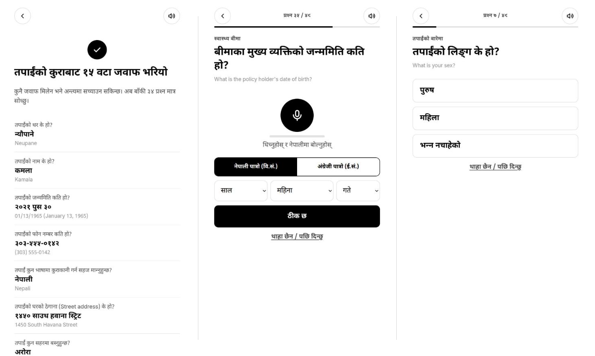
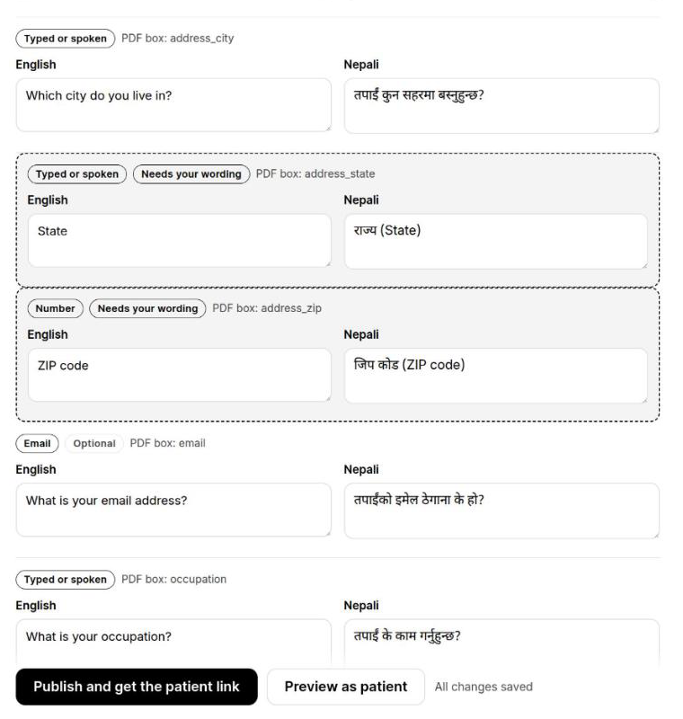
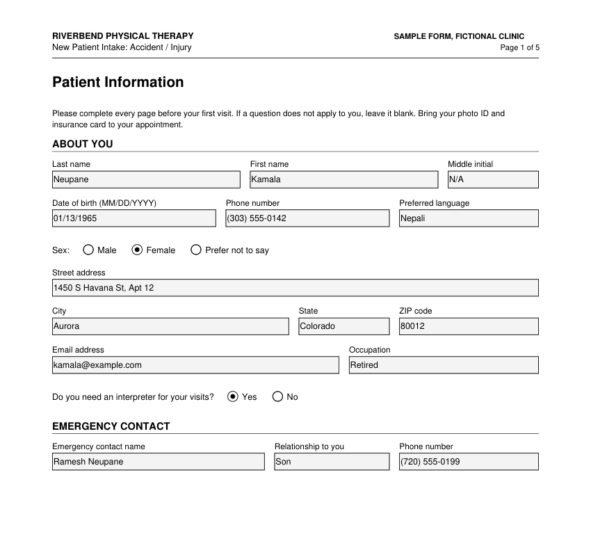

# Saathi (साथी)

Saathi lets a patient who doesn't speak English fill in a clinic's English intake form in Nepali, by voice or tap, and
sends the clinic its own PDF filled in English.

- **The clinic** uploads the fillable PDF it already uses. Saathi finds every box and its printed label, and turns
  each one into a plain question in English and Nepali. The clinic checks the wording and publishes a patient link.
- **The patient** opens the link on their phone and starts by **telling their story once**, in their own words:
  name, birthday, address, what happened, where it hurts. Saathi listens and fills in every answer it clearly heard
  (often a third of the form), then asks only what's left, one question at a time, read aloud in real Nepali. They
  answer by speaking, typing or tapping, and dates can be given in the Nepali calendar. Every answer is shown both
  ways before it's accepted: what they said, and the English that goes on the form. They review everything, read the
  consent sections in plain Nepali, and sign by typing their name.
- **The clinic** receives the completed PDF by email. The patient keeps a copy.



| The clinic checks the wording (label-only questions are flagged) | The clinic's own PDF, filled in English |
|---|---|
|  |  |

## Run it

Needs Python 3.12 and a modern browser (Chrome is what it was tested in).

```bash
cp .env.example .env      # then fill in the keys you have (see below)
./run.sh                  # http://localhost:8010
```

| Page | What it is |
|---|---|
| http://localhost:8010/clinic | Clinic side: upload a PDF (or use the sample), review, publish |
| http://localhost:8010/f/sample | Patient side, on the sample form. Works with no keys at all |
| http://localhost:8010/lab | Build step 1's speech test: Chrome's own Nepali recognition (it heard nothing, so Gemini listens instead) |

Use Chrome DevTools' device mode for a phone-sized view of the patient pages.

### Keys (`.env`)

| Setting | Needed for | Without it |
|---|---|---|
| `GEMINI_API_KEY` | Converting a new PDF; the story; turning spoken or typed Nepali into English; Nepali read-aloud for new wording | The sample form still works with typed English, taps, the date picker and its pre-recorded Nepali voice |
| `MAIL_MODE=send` + `SMTP_*` | Emailing the clinic (Zoho SMTP) | Emails are saved as `.eml` files in `data/outbox/` |

Gemini's free tier allows about 20 calls a day per model, so Saathi tries a chain of models (`GEMINI_FALLBACK_MODELS`,
`GEMINI_TTS_MODELS`) and skips one whose daily quota is spent. Read-aloud is recorded once per wording and kept.

Real sends are spaced at least `MIN_SEND_GAP_SECONDS` apart (default 300). An email that's held back is kept in
`data/outbox/`, and the patient still downloads their copy.

## How it works

```
clinic PDF ──► pdf_reader (PyMuPDF: boxes + printed labels) ──► converter (Gemini: EN + NE questions)
                                                                   │  checked against the PDF:
                                                                   │  every box once, real option values
                                                                   ▼
patient phone ◄── form.json ── clinic review & publish
   │  questions read aloud ◄── voice (Gemini text-to-speech, made once per wording, kept)
   │  the story, one recording ─► story (Gemini listens: every answer it heard, each checked like a single answer)
   │  one answer, recorded ─► answers (Gemini listens: Nepali + English)
   │  dates: AI finds the date, code converts Bikram Sambat → Gregorian exactly
   ▼
submit ─► answers_to_pdf ─► filler (PyMuPDF: values + typed signature) ─► mailer (Zoho) + patient download
```

- `app/`: the FastAPI server and its parts, one file per component in `devpost/spec.md`
- `web/`: plain HTML/CSS/JS with no build step. `fill.js` is the patient journey, `clinic.js` the clinic side,
  `voice.js` speech in and out
- `samples/pt-intake/`: a fictional 5-page PT accident intake form (`scripts/make_sample_form.py`) and its questions
- `devpost/`: the scope, PRD, spec and build checklist this was built from

## Tests

```bash
./run.sh test
```

Gemini and SMTP are replaced with fakes in tests. Nothing is sent or billed.

## Limits

This is a proof of concept. It's only been run with the fictional sample form and made-up answers. It isn't HIPAA
compliant, and Gemini's free tier may use prompts and recordings to improve Google's products, so don't use it with
real patient information. Saathi translates questions and answers; it never suggests what to answer. The story fills
only what the patient clearly said, and every answer is shown to them, in Nepali and English, before it's sent.

## License

MIT
